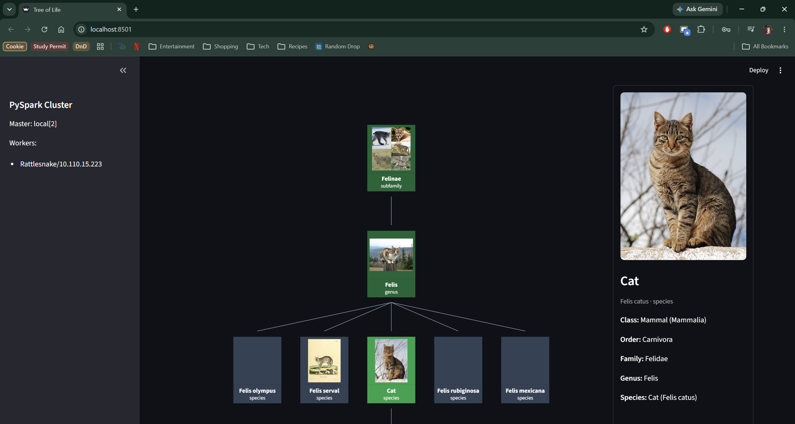
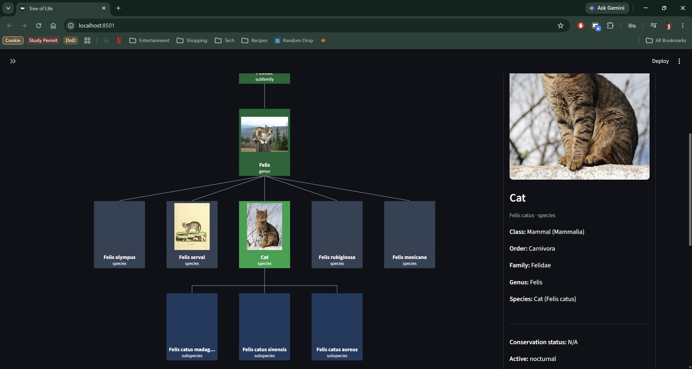
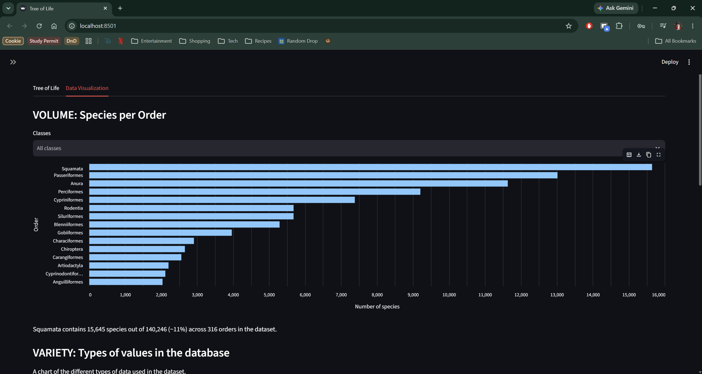
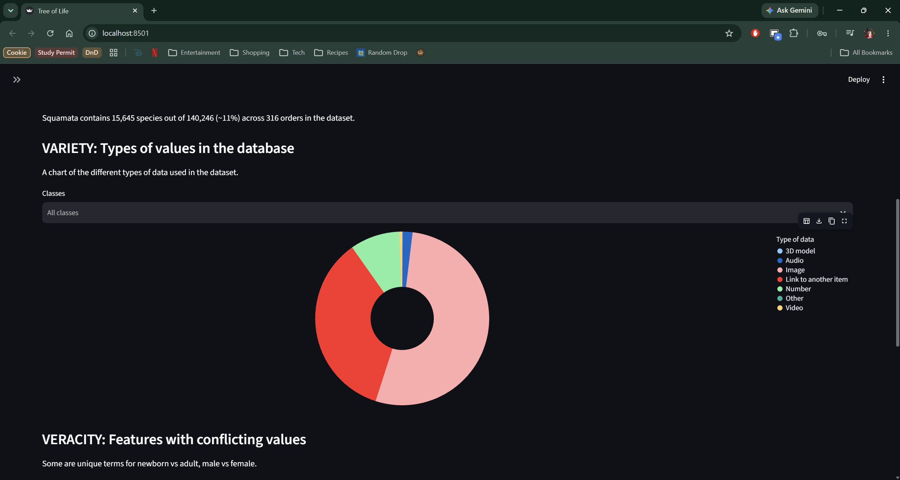
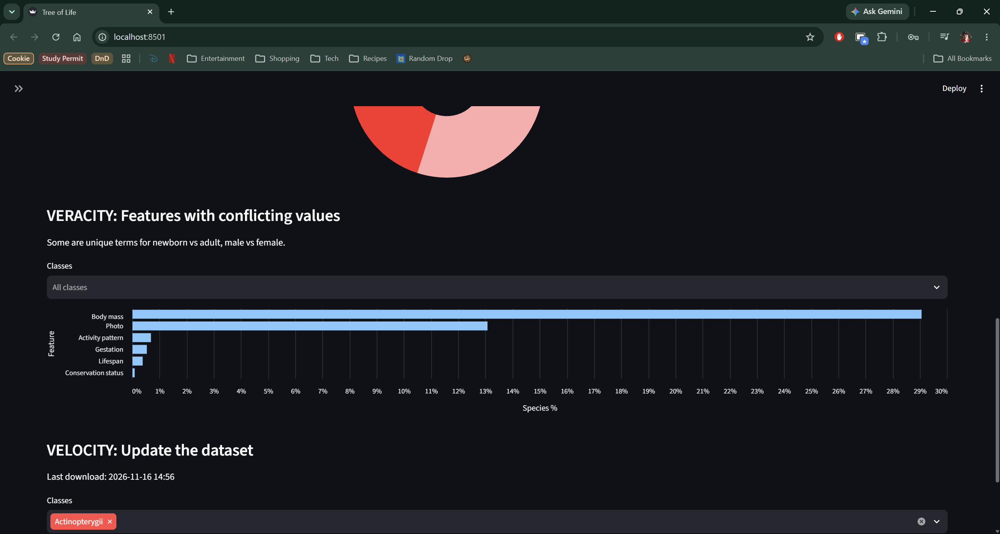
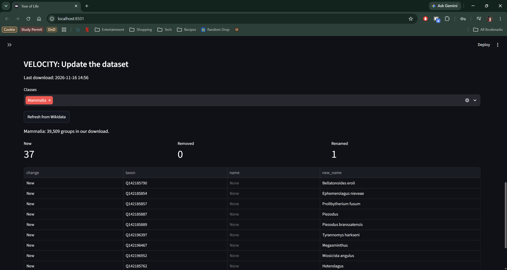

# TREE OF LIFE

An interactive animal taxonomy explorer built from Wikidata, processed using a PySpark cluster.

## Requirements

- Python 3.11.x
- Apache Spark 3.5.x
- Java 17

Both the MASTER and the WORKER devices will need to have the same version of all required components.

## Running the program

The data must be in `C:\bigdata\data` and `C:\bigdata\features` on every device. Alternatively you can change `FOLDER` in `app.py` if you want to use a different location.

1. **Set up Python environment.** Open Anaconda Prompt and enter the following.

   ```
   conda create -n bigdata python=3.11
   conda activate bigdata
   pip install findspark streamlit pandas pyarrow altair requests
   ```
2. **Set the master address.** In `app.py` on the MASTER, change these lines to the MASTER's IPv4 address (use `ipconfig`).

   ```python
   MASTER = "spark://MASTER-IP:7077"
   MY_IP = "MASTER-IP"
   ```

   ***OPTIONALLY, to run on locally on a single device, set `MASTER = "local[*]"` and skip steps 3 and 4.***
   
4. **Start the master.** On the MASTER device, use this command. Leave the window open.

   ```
   cd /d "%SPARK_HOME%"
   bin\spark-class2.cmd org.apache.spark.deploy.master.Master --host MASTER-IP
   ```

5. **Connect the workers.** On the WORKER device(s), use this command (change `4G` to the amount of RAM you want to use). Leave the window open.

   ```
   cd /d "%SPARK_HOME%"
   bin\spark-class2.cmd org.apache.spark.deploy.worker.Worker -c 2 -m 4G spark://MASTER-IP:7077
   ```
   
6. **Start the app.** On the MASTER, use these commands.

   ```
   conda activate bigdata
   cd C:\bigdata
   python -m streamlit run app.py
   ```

   Running the app will take a while the first time since it loads and organizes a large dataset##.

## Screenshots












